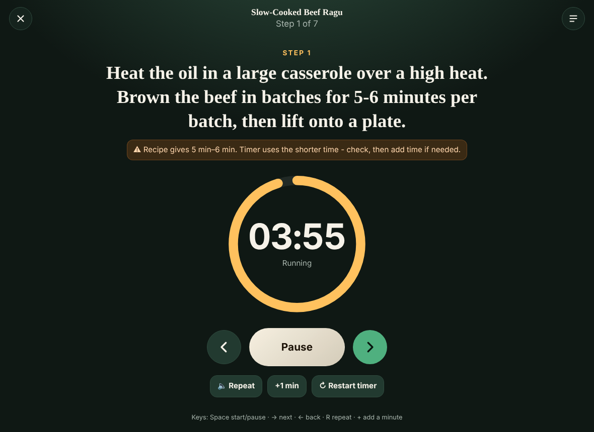

# Kitchen Coach

**Your recipe, one spoken, timed step at a time.**

Kitchen Coach reads a recipe file (PDF, Word .docx, XML, XHTML, HTML or TXT), works out the
ingredients, the method steps and every cooking time, then talks you through the recipe with
big, glanceable timers. Timers keep running in the background when you move on, so you can
have the onions frying while the pasta boils.

| Windows desktop | iPhone |
|---|---|
| Desktop icon, opens in its own app window, starts automatically when you sign in | Home-screen icon, full-screen, works offline |
| Recipes are read by the local Python engine | Recipes are read on the phone itself |



## Features
- Finds numbered steps, Word auto-numbered lists, HTML ordered lists, schema.org recipe data
  in saved web pages, and plain paragraphs under a "Method" heading.
- Understands times like `25 mins`, `1 hour 30 minutes`, `1½ hours`, `half an hour`, `20-25 minutes`
  (uses the shorter time and tells you), `a few minutes` (flagged as an estimate) and
  ignores `stir every 5 minutes`.
- Splits a long step with several timed actions into separate timed steps.
- Edit, reorder, add or delete steps and timers before you cook.
- Speaks each step aloud, chimes and speaks when a timer ends, repeats the alarm until you respond.
- Background timers tray, +1 minute, restart timer, pause/resume, keyboard shortcuts.
- Keeps the screen awake while cooking; picks up where you left off if the app is closed.
- Saved recipe library; everything stays on your device.

## Quick start

### Windows (ready-built)
1. Download `KitchenCoach-Windows.zip` from this repo's **Releases** page and unzip it.
2. Double-click **Install.bat**. A **Kitchen Coach** icon appears on your desktop and the app opens.
   It will also open automatically each time you sign in (run `Install.bat -NoStartup` to turn that off).

### Windows (from source)
Install Python 3.10+ from python.org, download this repo, then double-click `windows\Install.bat`.

### iPhone
1. Publish the web app with GitHub Pages (see below) and open
   `https://YOUR-USERNAME.github.io/kitchen-coach/` in **Safari**.
2. Tap **Share** > **Add to Home Screen** > **Add**. Launch it from the new icon.

### GitHub
1. Create a new repository called `kitchen-coach` and upload all of these files.
2. **Settings > Pages > Source: GitHub Actions** - the iPhone app is then published automatically.
3. **Actions > Windows build > Run workflow** builds `KitchenCoach.exe`; pushing a tag such as
   `v1.0.0` attaches `KitchenCoach-Windows.zip` to a Release.

Full instructions, with screenshots, are in **[docs/Kitchen_Coach_User_Guide.pdf](docs/Kitchen_Coach_User_Guide.pdf)**.

## Project layout
```
app.py               local web engine (Flask) - Windows build
launcher.py          starts the engine, opens the app window, stops when it closes
recipe_parser.py     reads PDF/DOCX/XML/XHTML/HTML/TXT and finds steps + timers
web/                 the app itself (also the iPhone / GitHub Pages build)
  parser.js          in-browser copy of the recipe reader (kept identical by tests)
  app.js, index.html, styles.css, sw.js, manifest.webmanifest, vendor/ (pdf.js, JSZip)
windows/             Install.bat, installer/uninstaller, exe build script
tests/               pytest + node tests, sample recipes, browser end-to-end test
docs/                user guide PDF and screenshots
.github/workflows/   tests, GitHub Pages deploy, Windows exe build
```

## Development
```bash
pip install -r requirements-dev.txt
python app.py                      # http://127.0.0.1:8765
python -m pytest -q                # Python tests
npm test                           # JavaScript parser must match the Python one
python tests/build_fixtures.py     # after changing the reading rules, then re-run both test suites
python -m playwright install chromium && python tests/e2e_browser.py   # full browser test
```

## Privacy and safety
Recipes never leave your device. The Windows engine listens only on `127.0.0.1`, rejects requests
for any other host name, limits uploads to 15 MB and reads XML with `defusedxml` (no external
entities). The web app has a strict Content Security Policy and loads nothing from the internet.

Licence: MIT. pdf.js (Apache-2.0) and JSZip (MIT) are included in `web/vendor`.
